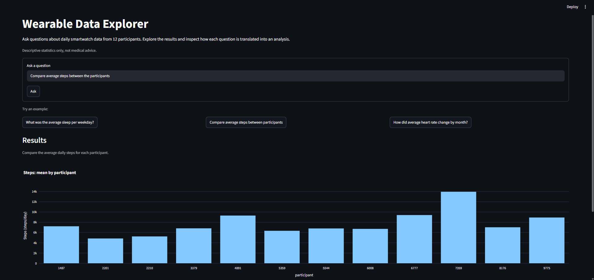

# Wearable Data Explorer

A research prototype for exploring wearable data through natural-language questions. Gemini translates each question into a structured query, which users can inspect and edit before Python calculates the result.

**Research Question**
> How can a language model support natural-language data exploration while keeping the analysis transparent and under the user's control?



---

## Overview

The app uses daily Withings ScanWatch data from 12 participants over 290 days, covering steps, activity, heart rate and sleep.See ([`data/README.md`](data/README.md)) for the dataset source and documentation.


---

## How it works

```
Question --> Gemini --> QuerySpec (JSON, validated, editable) --> pandas --> Results
```

For example, *"What was the average sleep per weekday?"* produces a structured query:

```json
{
  "metric": "sleep_hours",
  "agg": "mean",
  "by": "weekday",
  "participants": [],
  "start": null,
  "end": null,
  "explanation": "Calculate the average sleep duration for each weekday across all participants.",
  "unsupported_reason": ""
}
```
The app validates the query in code, calculates the result with pandas, and lets users inspect or edit the query. Results include the number of recorded observations used.


## Data exploration

Findings that shaped the design:

- **Missing measurements:** Date coverage is complete, but 1.1% of step counts, 4.3% of daily heart-rate averages and 6.9% of sleep measurements are missing. Sleep missingness reaches 20.3% for one participant.

- **Unusual values:** 65 nights exceed 12 hours of recorded sleep, including 49 for one participant. Some activity and heart-rate records also warrant caution. These values are retained rather than automatically corrected.

- **Participant differences:** Daily step counts vary substantially between participants, supporting participant-level comparisons rather than pooled summaries alone.

These findings describe this dataset, not a wider population. Missing values are not treated as zero, and the app does not provide medical advice.

---

## Project Structure

```
app.py                          # Streamlit app
src/wearable_data_explorer/
├── data.py                     # Data loading and preparation
├── analysis.py                 # Analysis and validation
├── query.py                    # QuerySpec and execution
├── visualisation.py            # Plotly charts
└── llm.py                      # Gemini integration
tests/                          # Automated tests
notebooks/                      # Data exploration
data/README.md                 
```

**Stack:** Python, pandas, Pydantic, Plotly, Streamlit, Gemini API, uv, pytest and Ruff.

---

## Getting Started

```
git clone https://github.com/lant96/wearable-data-explorer.git
cd wearable-data-explorer
uv sync
```

Download the data as described in [`data/README.md`](data/README.md) and place the CSV files in `data/raw/`.

Create a free API key in [Google AI Studio](https://aistudio.google.com/) and add it to a `.env` file in the project root:

```
GEMINI_API_KEY=your-key-here
```

Run the app:

```
uv run streamlit run app.py
```

Run the tests and the linter:

```
uv run pytest
uv run ruff check
```

---

## Limitations

- Small dataset: 12 participants, with no basis for population-level conclusions.
- Limited query vocabulary: one metric per question, with supported aggregations and groupings.
- Model interpretation quality has not been systematically evaluated.
- Partial months and low observation counts are not yet explicitly flagged.

**Next steps:** Evaluate interpretations against a fixed set of questions, improve warnings for incomplete data, support comparisons between metrics and explore local model options.

---

## References

- Matias, I. and Wac, K. (2022). *Physical Activity, Heart Rate, and Sleep data collected with a Smartwatch (N=12)*. Université de Genève, Yareta. https://doi.org/10.26037/yareta:mdrfwk26wzhgbfz5bxe4lv3v4i (CC BY 4.0)
- Igor Matias and Katarzyna Wac, "Dejà vu: Recurrent Neural Networks for health wearables data forecast", 2022, IEEE Xplore. https://doi.org/10.1109/ICMLA55696.2022.00264

---

## Author

Athanasia Lantouri

Applied Machine Learning | Human-Centered AI | Interactive Systems

GitHub: <https://github.com/lant96>
